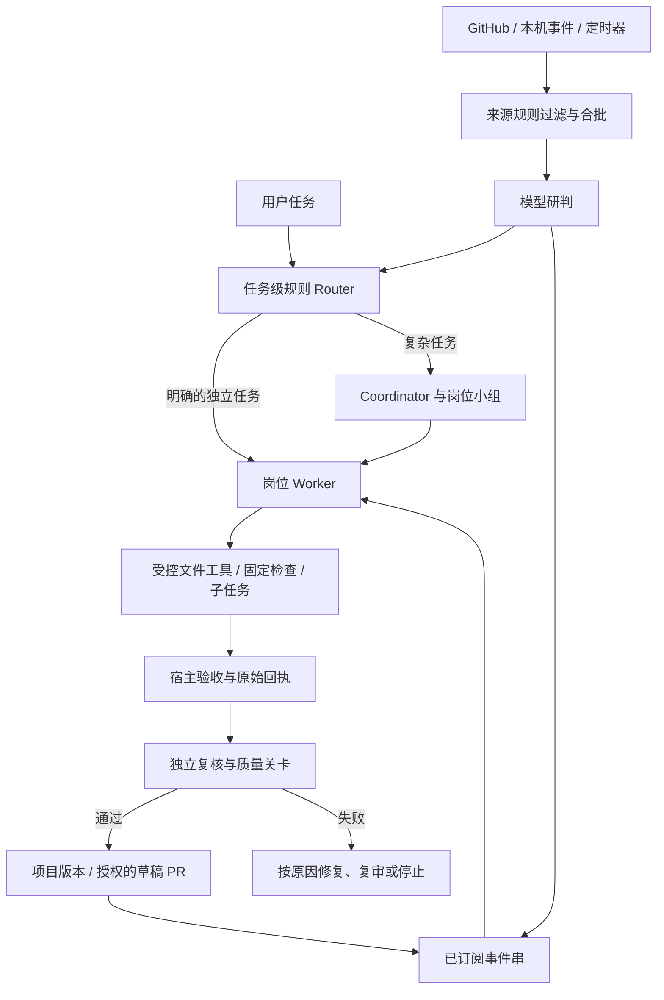

# 雪站 · Yuki Station

**一个本地优先的多模型 Agent 工作台，面向有明确边界、需要真实验证和持续跟进的工作。**

雪站把项目资料、任务分工、工具执行、审查证据、交付版本和后续事件放在同一个工作空间。它既可以让单个 Worker 跟进一项独立任务，也可以让 Coordinator 理解复杂需求、拆分模块并协调多个岗位。项目吸收了 Lancer 在工作区、角色边界和执行接口上的启发，也参考了 DeepSeek Super-agent 对事件、任务、执行、订阅和恢复的建模。

> 当前公开快照对应桌面版 **0.2.8（12）**，状态记录截至 2026-11-09。项目仍在实验和验证阶段，本文会区分已实现、已验证与规划中。请先阅读[状态与验证](docs/STATUS.md)。

## 想解决什么问题

团队的需求不总是一条完整的指令。有人提交一个较大的项目任务，也有人在同一个 PR 或会话里不断提出后续意见。传统单次对话容易丢失文件版本、执行过程和后续关联，而把每条消息都交给模型重新判断也会增加延迟和成本。

雪站希望提供一条可追溯的工作路径：

1. 把项目约定、角色、工具权限和验收标准明确下来。
2. 独立任务由规则路由到合适 Worker，复杂任务由 Coordinator 拆解并协调。
3. Worker 在授权范围内读取、搜索、修改和执行固定检查，必要时派生受限的执行子任务。
4. 宿主保存真实回执，执行检查、独立复核和质量裁决，验收通过后交付项目版本。
5. 来源事件按规则筛选；已认领事件串的后续反馈直接送回原 Worker，在同一会话中继续。

## 架构概览



图中分发是**任务级**的。单个复杂任务内部仍可由 Coordinator 协调多个岗位；单 Worker 路线则让执行者持续负责自己的任务。当前任务级 Router 使用规则与用户明确的单模块合同；自动选择路线的通用轻模型语义 Router 仍是计划。Trigger 的模型研判是另一环节。

## 项目特点

### 项目与岗位

每个项目保存业务说明、资料、岗位配置、会话和文件版本。任务可指定工作小组，按岗位能力分配模型。直接任务要求明确岗位、范围和验收标准，开发任务仍保留独立产物审查。复杂任务可以拆成依赖明确的模块，按完成事件调度。

### 真实工具与可验证交付

支持按项目和岗位授权 `workspace` 工具，允许在受控副本中列目录、读取、搜索、按文件指纹写入，以及运行本机预先登记的固定检查。Worker 可派生同型号执行子任务，父 Worker 检查其候选、显式接纳，并在自己的副本上重新测试。工具返回、实际检查、模型审查和最终交付分别留证。

可把“原始失败复现”与子任务检查、接纳、父级重验写入冻结合同。宿主在首个 Worker 调用前执行被选定的基线检查，失败事实和原始输入绑定；完成声明不能替代机器检查。

### 按原因分流

验收失败后，具体代码缺陷进入有限定向修复；证据未验证或审查分歧可以对同一产物做有界复审；配置缺失、执行结果未知或需要修改授权时停止并保留原因。每次复审和修复仍受原标准与质量关卡约束。

### 事件驱动与订阅

来源支持 GitHub 轮询、本机认证的自定义事件和定时事件。来源规则先按身份、容器和事件类型过滤，再对候选合批并按配置研判。观察、研判和自动接单是不同模式。

开启订阅后，已认领事件串的后续反馈进入原任务的持久队列。任务结束后，在原项目与会话中从已交付版本继续，固定原 Worker 身份与模型。GitHub 发布后的 PR 评论、审核、行内评论和明确关联的 CI 可以归入同一事件串；后续通过质量关卡可更新同一个 PR。来源权限、身份规则和冻结合同仍然生效。

### 状态与恢复

会话和派工事实由 SQLite 持久保存，Trigger 的事件与外部操作使用单独的权威存储。任务进入队列、占用执行资源、模型返回、检查通过和项目交付是不同状态。服务重启后，来源与未完成工作按显式恢复协议处理；未知结果保留为未知。

## 与 Lancer、Super-agent 的关系

| 关注点 | 借鉴的思路 | 雪站当前做法 |
| --- | --- | --- |
| 工作区与执行边界 | Lancer 的工作空间、执行接口和模块职责 | 本机项目工作台，统一执行器入口，按项目和岗位配置工具 |
| 状态与恢复 | Super-agent 的任务、执行尝试和持久工作 | 会话 SQLite、派工记录、Trigger Inbox 与外部效果记录 |
| 任务分派 | 任务路由与独立执行 | 规则 Router 支持单 Worker，复杂需求保留 Coordinator 小组流程 |
| 后续反馈 | Super-agent 的 Thread / Subscription / Input | 显式订阅事件串，在原会话中继续，并记录输入是否实际被 Worker 读取 |
| 验收与交付 | 审查、回执与持续工作 | 冻结合同、宿主检查、独立复核、有限返工和受控交付共同组成质量链 |

这里的“融合”指独立实现与架构学习。雪站并未整仓替换为 Lancer 或 DeepSeek Harness。两个上游项目及各自许可仍归原作者所有，引用固定版本以便读者复核：

- [Lancer，commit 019b2f1](https://github.com/raylee-ai/lancer/tree/019b2f16f746df4160f2fa9937a4e6c50c13c6f4)
- [DeepSeek dsh-superagent-prototype，commit 6337fc8](https://github.com/deepseek-ai/dsh-superagent-prototype/tree/6337fc823ce20251c8de8085948165c81aaa701e)
- [对比、依据与边界](docs/COMPARISON.md)

## 快速开始

基础工作台使用 Python 标准库和 SQLite，不要求先安装 Node 或额外 Python 包。请使用 **Python 3.9 或更新版本**，在仓库根目录运行：

```sh
cd lancer-local
python3 app.py --data-dir ./workspace-data --port 8767
```

在浏览器打开 `http://127.0.0.1:8767/studio`。服务监听本机地址。新数据目录由本机创建，克隆代码不会带入他人的项目或密钥。

在“连接模型”中填写自己的服务地址、准确型号与凭据，再按需求配置项目、岗位和固定检查。内置连接名称与型号是示例配置，并非对提供商身份、可用性或模型能力的保证。**输入密钥之前请确认显示的服务地址属于你信任的提供商。**调用费用由所连接的服务计收。

基础 Web 工作台与可选原生 Codex / MCP 桥接的要求不同。macOS Apple Silicon 桌面测试构建包含独立 Python，当前未完成 Apple Developer ID 签名、公证与另一台物理 Mac 验收。Intel、Windows、Linux 的桌面分发尚未完成。安装、源码布局和本地数据说明见[使用与开发](docs/GETTING_STARTED.md)。

## 学习目录

从系统概念开始，也可以按代码模块跳转：

| 章节 | 你将了解 |
| --- | --- |
| [01 · Agent、角色与执行器](docs/learning/01-agents-and-executors.md) | Coordinator、Router、Worker、Executor 与子任务的边界 |
| [02 · 模块与队列调度](docs/learning/02-routing-and-scheduling.md) | DAG、任务队列、公平性与资源槽 |
| [03 · 事件与订阅](docs/learning/03-triggers-and-subscriptions.md) | Source、Trigger、Thread、筛选、认领与直通 |
| [04 · 合同、回执与质量](docs/learning/04-contracts-and-quality.md) | 固定标准、原始回执、独立复核与返工 |
| [05 · 持久化与恢复](docs/learning/05-persistence-and-recovery.md) | SQLite、幂等、未知结果与恢复 |
| [06 · 评测与成本](docs/learning/06-evaluation-and-cost.md) | 成功交付、Token、耗时和可比实验 |
| [07 · 开源融合与扩展](docs/learning/07-inspiration-and-extension.md) | 如何阅读上游、增加来源并保持权限边界 |

## 当前进度与限制

- 已实现本机项目工作台、规则任务路由、有限并发、岗位工具、冻结契约、宿主验收、独立复核、返工分流和订阅续办。
- 0.2.8 的自动后台两轮 Worker 流程和同 PR 更新已在本机使用**模拟模型与模拟 GitHub**验证；真实远端 PR 跟进和真实模型持续交付仍待验收。
- 三个旧源码需求的模型复测为 2/3 交付。之后的三轮合成子任务实验没有完成交付，两组数据不混为一个成功率。仅在同一任务前后都质量达标时比较效率。
- 普通源码路径依赖本机 Python，桌面测试包面向 macOS Apple Silicon。模型与 GitHub 凭据当前保存在服务内存，服务重启后需要重新连接。
- 真实群聊、邮件及日历账号适配、操作系统唤醒、通用依赖安装与自动测试发现尚未完成。固定检查脚本以本机用户权限运行，不能视为完整操作系统沙箱。
- 订阅目前针对显式启用的 `auto + direct` 来源。单条后续消息超过 12000 字符会保留待处理，需人工拆分。

详见[状态与验证](docs/STATUS.md)、[路线图](docs/ROADMAP.md)和[安全与权限](docs/SECURITY.md)。

## 开发与验证

```sh
cd lancer-local
python3 -B -m unittest discover -p 'test_*.py' -q
node --test test_studio_business_ui.js test_studio_visual.js test_flow.js test_studio_replay.js
```

完整可选 MCP 集成测试需要 Node 与对应依赖，桌面构建需要 macOS、Xcode 命令行工具和固定版本 Python 运行时。关于测试结果的范围、可选依赖与源码快照差异，请阅读[开发指南](docs/GETTING_STARTED.md)。

## 许可证与致谢

项目采用 [MIT License](LICENSE)。模型图标、可选桥接依赖与 Python 运行时保留各自的来源和许可证，详见 [第三方来源](docs/THIRD_PARTY.md)。感谢 [Lancer](https://github.com/raylee-ai/lancer) 与 [DeepSeek Super-agent 原型](https://github.com/deepseek-ai/dsh-superagent-prototype) 的公开工作。
